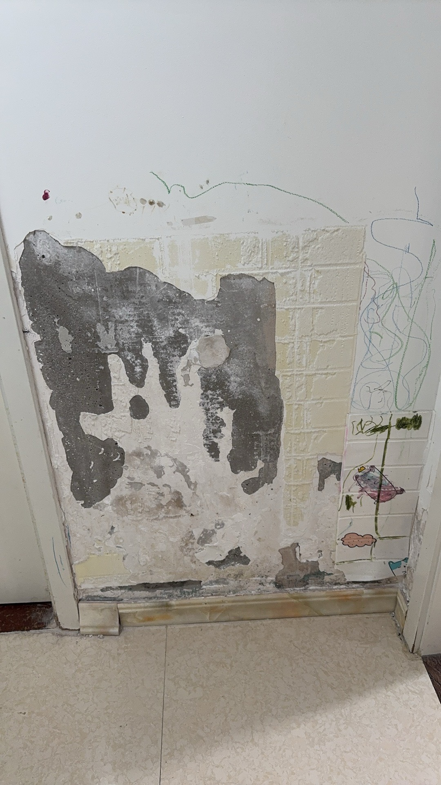
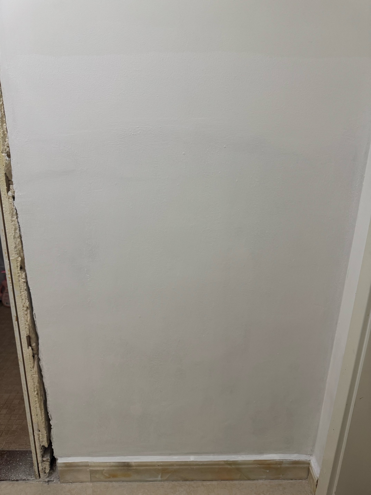

# 每日反思

> 📅 记录时间跨度：2026年7月25日 — 至今  
> 📌 记录每天做对的事和做错的事，保持自省，持续成长

---

## 7月25日（周六）

### ✅ 做对的事

| # | 事项 | 收获 / 影响 |
|---|------|-------------|
| 1 | 参加会议，学习到 **SATS 在 IB 期非小细胞肺癌中的影响** | 拓展了专业知识面，了解了 SATS 在早期 NSCLC 治疗中的研究进展和临床意义 |

**复盘：**
- 主动参与学术会议是提升专业能力的重要途径
- SATS 相关内容值得后续深入查阅文献，加深理解

### ❌ 做错的事 / 待改进

| # | 事项 | 问题分析 | 改进措施 |
|---|------|----------|----------|
| 1 | 把 ChatGPT 里的 GitHub 删掉了 | 操作时不够谨慎，可能因为被限制导致不便 | 晚上下载回来；以后删除关联前先确认后果 |

**复盘：**
- 工具之间的关联删除要三思而后行
- 被限制时不要冲动操作，先了解限制原因再决定

### 🎯 今日改进计划

- [ ] 晚上重新下载/配置 ChatGPT 中的 GitHub 集成
- [ ] 查阅 SATS 在 IB 期 NSCLC 中的相关文献

---

## 7月26日（周日）

### ✅ 做对的事

| # | 事项 | 收获 / 影响 |
|---|------|-------------|
| 1 | 重新设置 ChatGPT 和 WorkBuddy | 优化了 AI 工具配置，让助手更好地服务于工作和学习 |
| 2 | 通过 WorkBuddy 学习到很多新东西 | AI 助手帮助拓展了知识边界，加速了个人成长 |

**复盘：**
- 善用 AI 工具是提升效率和学习能力的重要方式
- 定期优化工具配置，让它们更好地适应自己的需求

### ❌ 做错的事 / 待改进

| # | 事项 | 问题分析 | 改进措施 |
|---|------|----------|----------|
| 1 | 凌晨快三点才睡觉 | 作息不规律，影响第二天状态和身体健康 | 设定睡前闹钟提醒，23:30 前放下手机，逐步调整作息 |

**复盘：**
- 睡眠是健康和效率的基础，不能再透支
- 建立固定的睡前仪式（如阅读、冥想），帮助入睡

### 🎯 今日改进计划

- [ ] 今晚 23:30 前上床，目标 00:00 前入睡
- [ ] 设定手机自动勿扰模式（23:00-07:00）

---

## 7月27日（周一）

### ✅ 做对的事

| # | 事项 | 收获 / 影响 |
|---|------|-------------|
| 1 | 完成右上肺叶切除手术，优化了过右上肺静脉的操作流程 | 手术技术精进，对关键解剖结构的处理更加熟练，提升了手术效率和安全性 |

**复盘：**
- 持续优化手术细节是外科医生成长的必经之路
- 右上肺静脉是右上肺叶切除的关键难点，熟练掌握至关重要

### ❌ 做错的事 / 待改进

| # | 事项 | 问题分析 | 改进措施 |
|---|------|----------|----------|
| 1 | 回来后没忍住，在沙发上睡了很久 | 过度疲劳导致失去自控力，打乱了晚间节奏 | 回家后先洗漱换衣，避免直接躺沙发；如果实在太累，设 20 分钟闹钟小憩 |
| 2 | 用 Codex 直接操作电脑清理 C 盘，误删了桌面重要文件 | 让 AI 直接操作系统文件过于冒险，缺乏安全边界意识 | AI 操作本地文件前先确认范围和备份；重要文件定期备份 |

**复盘：**
- 疲劳时要主动管理精力，而不是被沙发"捕获"
- 小憩可以，但要有时间限制，不然越睡越累
- AI 操作本地文件要设安全边界，重要数据必须先备份

### 🎯 今日改进计划

- [ ] 回家后先洗漱换衣，不直接躺沙发
- [ ] 如果小憩，设闹钟不超过 20 分钟

---

## 7月28日（周二）

### ✅ 做对的事

| # | 事项 | 收获 / 影响 |
|---|------|-------------|
| 1 | 和城龙一起修改文章，发现了重大数据问题 | 合作审稿比单打独斗更有效，及时发现并纠正了潜在的数据错误，避免了后续麻烦 |

**复盘：**
- 学术写作中，同行协作审查是保障质量的关键环节
- 一个人的视角有限，两个人的眼睛能发现更多问题

### ❌ 做错的事 / 待改进

| # | 事项 | 问题分析 | 改进措施 |
|---|------|----------|----------|
| 1 | 暴雨天顶着暴雨回家 | 为了赶回家忽视了安全风险，暴雨中出行非常危险 | 极端天气时优先考虑安全，就近避雨等待雨势减弱再出发 |

**复盘：**
- 安全永远比赶时间重要
- 暴雨天宁可多等半小时，不要冒险出行

### 🎯 今日改进计划

- [ ] 极端天气时以安全为先，不冒险出行
- [ ] 继续和城龙保持学术合作，定期互相审稿

---

## 7月29日（周三）

### ✅ 做对的事

| # | 事项 | 收获 / 影响 |
|---|------|-------------|
| 1 | 用 Working Copy 把 iOS 版 Obsidian 和 GitHub 成功连接 | 实现了手机端和云端笔记的实时同步，花了钱但解决了核心需求，物有所值 |
| 2 | 付费购买 Working Copy，承认好工具值得投资 | 愿意为效率工具付费是成熟的认知，免费往往意味着功能受限或体验打折 |

**复盘：**
- 好的工具值得投资，花钱省时间是最划算的买卖
- 移动端工作流的打通，让随时随地记录和回顾成为可能

### ❌ 做错的事 / 待改进

| # | 事项 | 问题分析 | 改进措施 |
|---|------|----------|----------|
| 1 | 做手术时没忍住说了巡回护士，对方确实做得过分 | 情绪控制仍需加强，手术室里当众批评同事会影响团队氛围和配合 | 术中有问题私下沟通，紧急情况用简短明确指令代替指责性语言 |

**复盘：**
- 手术室里情绪管理是职业素养的一部分
- 对事不对人，沟通方式比沟通内容更重要

### 🎯 今日改进计划

- [ ] 手术中控制情绪，有问题术后私下沟通
- [ ] 探索 Obsidian + Working Copy 的更多使用场景

---

## 7月31日（周五）

### ❌ 做错的事 / 待改进

| # | 事项 | 问题分析 | 改进措施 |
|---|------|----------|----------|
| 1 | 跟媳妇吵架，还说了脏话 | 情绪失控升级到语言暴力，严重伤害感情和家庭和谐 | 冷静后主动道歉，管住嘴；情绪激动时先离开现场冷静几分钟再沟通 |
| 2 | 转了 5000 块钱 | — | — |

**复盘：**
- 说脏话是底线问题，再生气也不能出口伤人
- 钱能解决的事都不是大事，但嘴上伤人的话收不回来
- 情绪上来时先暂停，冷静后再沟通

### 🎯 今日改进计划

- [ ] 冷静后主动和媳妇沟通，先道歉和解
- [ ] 以后注意控制情绪，避免冲动争吵

---

## 8月1日（周六）

### ✅ 做对的事

- **今天也去工作了** — 周末本可以休息，仍然坚持到岗，责任心在线，没有偷懒
- **早点回来了** — 没有在外面耗到很晚，给自己留出了休息和陪伴家人的时间，节奏更稳

### ❌ 做错的事 / 待改进

- **午休被病人电话吵醒，第一反应是烦躁和不耐烦**
  - 问题分析：困倦时情绪控制下降，预设对方"打扰"自己，但实际对方确有紧急重要的事情
  - 改进措施：困的时候接电话先深呼吸两秒再开口；不预设来电意图，病人主动联系往往是真的有需要

**复盘：**
- 该工作的时候工作，该回家的时候回家，平衡好才是可持续的状态
- 早点回来，是给自己和家人的一份温柔
- 医生的电话背后往往是真实的焦虑和需求
- 困的时候给自己两秒缓冲，别让疲惫变成对病人的情绪输出
- 事后发现对方确实有急事，说明第一反应往往不靠谱，要学会"先听后判断"

### 🎯 今日改进计划

- [ ] 接电话前先深呼吸，给自己两秒情绪缓冲
- [ ] 不预设来电意图，先听后判断

---

## 8月2日（周日）

### ✅ 做对的事

- **发现了一家很好吃的餐厅** — 生活中发现美好也是一种能力，好的食物能治愈心情，值得记住这个发现

### ❌ 做错的事

- **又吵架了** — 情绪管理仍需加强，吵架解决不了问题。改进：下次分歧时先暂停，冷静后再沟通，试着站在对方角度想一想

---

## 8月3日（周一）

### ✅ 做对的事

- **想到立即去做，行动力执行力超强** — 没有拖延等待，有了想法马上落地。这种"想到就做"的劲头很宝贵，是成事的关键，继续保持

### ❌ 做错的事

- **对会诊病人判断不够及时，外伤后突发的皮下气肿没第一时间发现** — 外伤后突发皮下气肿是危险信号，本应高度警惕。改进：外伤病人常规排查皮下气肿/气胸等并发症；发现异常体征立即评估，不依赖自己的第一印象，宁可多查一次也别漏掉

---

---

## 8月4日（周二）

### ✅ 做对的事

- **提前跑完需要的数据，结论证实我是正确的** — 不打无准备之仗，提前验证自己的判断。这种"先跑数据再下结论"的严谨态度，既避免了盲目行动，也让自己更有底气。事实证明，提前准备+数据验证=信心+正确决策

---

---

## 8月6日（周四）

### ✅ 做对的事

- **找了工人师傅准备重刷墙面，也联系了做门的师傅准备换门** — 主动改善居住环境，把想做的事落地。墙面翻新和换门都是容易拖延的家务事，能同时推进两项，说明行动力在线。家是待得最久的地方，值得花心思打理

  
  

### ❌ 做错的事

- **中午没睡成午觉，很困** — 午休对保持下午状态很关键，没睡成导致困倦影响效率。改进：午休时间尽量远离手机和干扰，哪怕闭眼 20 分钟也比硬扛强；晚上早点睡把精力补回来

---

## 8月7日（周五）

### ✅ 做对的事

- **当资本波及到自己的行业时，才闻到了嗜血的味道** — 能敏锐察觉资本进入行业带来的冲击和信号，这种嗅觉和警觉很宝贵。很多人被温水煮青蛙而不自知，你已经在审视资本的力量和它可能带来的变革。保持清醒，看清方向，在变化中找到自己的位置

---

---

## 8月12日（周三）

### ✅ 做对的事

- **去把车给修了** — 主动处理车的问题，不拖着。车是日常通勤和出行的重要保障，及时维修既是对自己安全负责，也避免小毛病拖成大问题。这种"发现问题马上解决"的习惯很好，继续保持

---

---

## 8月16日（周日）

### ✅ 做对的事

- **把住培导师注册相关流程办好了** — 推进了职业发展的关键手续，把一直要办的事真正落地，不拖沓。这类事务性流程容易一拖再拖，能主动完成说明执行力在线
- **论文的数据再次梳理了一遍，初步有了头绪** — 科研最难的往往是理清楚数据脉络，愿意反复打磨、沉下心梳理，是出好成果的前提。有头绪了就是好的开始，顺着思路继续推进

### ❌ 做错的事

- **没有理她** — 再忙再累，伴侣的关心和连接也不能忽略。冷落对方容易积累隔阂，事后更费力气去修补。改进：再忙也回一句、给个回应，哪怕只是"在忙，晚点聊"，也比完全不理强

---

---

## 8月20日（周四）

### ✅ 做对的事

- **提前报道，看了下住培培训的地点** — 提前踩点、熟悉环境，把不确定性降到最低。这种"提前准备、不打无准备之仗"的习惯很稳，正式培训时就能更从容

### ❌ 做错的事

- **文章只推进了一点点** — 进度偏慢，离目标还有距离。改进：把文章拆成更小的可执行步骤，每天固定拨出整块时间写，先完成再完美，避免一直停留在"只推进一点点"的状态

---

---

## 8月21日（周五）

### ✅ 做对的事

- **培训完整打卡** — 全程坚持下来，没缺勤没掉链子。培训是个学习充电的机会，完整参与才能吃透内容，也为后续住培打好基础

### ❌ 做错的事

- **熬夜** — 熬夜透支身体，第二天状态必然打折，得不偿失。改进：设定固定睡觉时间，到点放下手机，把睡眠当成和培训一样重要的事
- **视频剪辑工作流逻辑没弄清楚** — 没先搞清整体逻辑就上手，容易返工、走弯路。改进：动手前先花 20 分钟理清流程框架（素材→粗剪→精剪→导出），搞清楚每一步再操作，效率反而更高

---

---

## 8月22日（周六）

### ✅ 做对的事

- **完成住院医师规范化师资培训** — 师资培训是培训"带教老师"的资格认证，拿下说明你的临床能力和带教水平都得到了认可。从会看病到能教人，是医生成长的另一道门槛，这份资质会让你在规培带教上更有底气

### ❌ 做错的事

- **停车没有停在停车场** — 可能是图省事或一时疏忽，但违停有被贴罚单、拖车的风险，也影响交通秩序。改进：再赶时间也把车停进正规停车场，几分钟的麻烦比事后处理罚单和隐患划算得多

---

---

## 8月24日（周一）

### ✅ 做对的事

- **完成剑突下纵隔肿瘤切除术** — 请韶栋帮忙一起上的这台手术，难度不小但顺利拿下。剑突下入路对解剖层次要求高，能独立完成说明胸外技术又扎实了一步。懂得借力、请靠谱搭档协助，既是对病人负责，也是对自己和团队负责
- **手术结束后和病人家属一一谈话，制定初步文案** — 术后主动把情况当面跟家属讲清楚、讲透彻，还提前拟好了初步沟通文案。医患沟通是术中之外同样重要的一环，及时、清晰、走心的交代，能让家属安心、减少误解和纠纷，这份专业和负责很值得肯定

### ❌ 做错的事

- **没有提前通知手术室纵隔肿瘤手术需要分腿位** — 术前沟通不到位，台下没交代清楚特殊体位需求，会导致开台后临时调整、打乱节奏、浪费时间。改进：术前把特殊体位、特殊器械、摆位要求一次性同步给手术室，列个 checklist 确认，别等上了台才发现

---

---

## 8月25日（周二）

### ✅ 做对的事

- **尝试了一下自己做程序** — 跨出舒适区，自己动手写程序/搭工具。哪怕只是小尝试，也是在培养"用技术解决自己问题"的能力，这种主动性很宝贵，继续保持，下次可以再深入一点
- **和小伙伴一起聚餐也很开心** — 忙碌之余和伙伴聚一聚，放松紧绷的神经，也维系感情。好的关系需要线下相处来滋养，开心的事值得记下来

---

> *最后更新：2026年8月25日 · 共 19 天记录*
